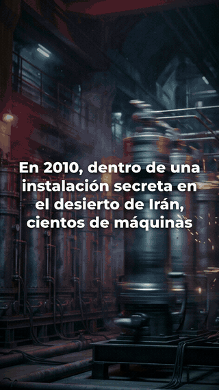

# faceless-agent — a Claude Code plugin that turns your script and voice into a documentary

[](https://github.com/MartinOlivero/faceless-agent/releases)
[](./LICENSE)
[](https://github.com/MartinOlivero/faceless-agent/actions/workflows/ci.yml)



You write the story and record it in your own voice. `faceless-agent` does the editing: it times
an AI-generated image to every scene, adds slow camera moves, glitch cuts, a CRT look and synced
subtitles, mixes music and sound effects under your voice, and builds the matching vertical short.

You never open a video editor. You talk to Claude Code, and it runs the pipeline.

The clip on the right is the plugin's own output: 49 seconds, rendered in 47 seconds on an M3 Pro.

<details>
<summary>🇪🇸 <strong>¿Hablás español?</strong> — resumen rápido</summary>

<br>

**faceless-agent** convierte **tu guion y tu voz grabada** en un documental sin cara: una imagen
generada por IA por escena, movimiento de cámara, cortes con glitch, look de tele vieja, subtítulos
sincronizados, música y efectos, y además el short vertical del mismo caso.

Vos escribís y narrás. La IA sólo produce. No abrís ningún editor de video: le hablás a Claude Code.

Las tres skills están escritas en español: `setup` (prepara todo y te explica qué cuesta cada
cosa), `brand-setup` (el look de tu canal) y `nuevo-documental` (el video, paso a paso).

**Instalación:**

```
/plugin install faceless-agent --marketplace MartinOlivero/faceless-agent
```

Probado de punta a punta sólo en macOS. El método completo, con las clases y los casos, se enseña
en la [comunidad de IamAutom](https://comunidad.iamautom.com).

Hecho por **Martín Olivero / [IamAutom](https://iamautom.com)**.

</details>

## What goes in, what comes out

| You bring | The plugin makes |
|---|---|
| A script, split into scenes | One AI image per scene, in a consistent style |
| Your recorded voice (`.wav` or `.mp3`) | Word-level transcript, used to place every subtitle and cut |
| A few timing decisions, in a small `config.json` | A 16:9 documentary and a 9:16 short, both mixed to −14 LUFS |

The script and the voice stay yours on purpose. A channel where a person writes and narrates, and
AI handles production, sits on the safe side of YouTube's authenticity rules. Declare the AI
production in your description anyway.

## Install

```
/plugin install faceless-agent --marketplace MartinOlivero/faceless-agent
```

On Claude Code older than 2.1.275, use the two-step form:

```
/plugin marketplace add MartinOlivero/faceless-agent
/plugin install faceless-agent
```

## Use

1. **Set up once.** Ask for the `setup` skill ("configurá el plugin"). It detects your system,
   offers to install the free tools, and walks you through the paid API keys, saying what each
   one is for and how it is billed before you sign up for anything.
2. **Make it yours.** Ask for `brand-setup` ("configurá mi marca"). It interviews you and writes
   `~/.faceless/brand.json`: accent color, fonts, subtitle size, how much CRT, glitch and vignette
   you want (none is a valid answer), your outro and your short's call to action. Skip this and
   your videos carry a placeholder outro that says "TU NOMBRE".
3. **Make a documentary.** Ask for `nuevo-documental` ("armemos un caso"). It walks the whole
   pipeline: script, voice mastering, transcription, images, assembly, render, audio mix, the
   vertical short and the cover.

## The one file you edit per video

Everything that changes from one video to the next lives in a `config.json` next to your images.
Claude writes it with you from the transcript; you can also edit it by hand.

```json
{
  "ESCENAS_INICIO": [0.0, 24.0, 46.0, 73.0],
  "KEN_BURNS": [[[1.15,0,0],[1.32,-70,-40]], [[1.30,-60,30],[1.12,40,-20]],
                [[1.12,50,30],[1.30,-50,-30]], [[1.32,0,-45],[1.14,0,35]]],
  "GLITCH_EXTRA": [1],
  "CALLOUTS": [[48.0, "NATANZ · IRÁN — 2010"]],
  "MUSICA": [["acto1.mp3", 0.0, 80.0, 0.18], ["acto2.mp3", 73.0, 999.0, 0.20]],
  "SFX": [["riser.mp3", 0.3, 0.40], ["impact.mp3", 46.0, 0.55]]
}
```

`ESCENAS_INICIO` is the second each image enters. `KEN_BURNS` is the camera move per scene, as a
start and end `[zoom, x, y]`. `CALLOUTS` are on-screen fact plates. `MUSICA` and `SFX` name files
and when they play. A misspelled key stops the run with an error instead of quietly falling back
to the demo values.

Your channel's look is a second file, `brand.json`, written once. Both are passed in order, look
first and timing second, so one video can override the brand when it needs to.

## What it costs to run

The plugin is free and MIT-licensed. Running it uses:

- **Free tools:** ffmpeg, Node 22 or newer, uv, and [HyperFrames](https://hyperframes.dev), the
  engine that renders the video.
- **Image generation, paid per use:** a Gemini API key with billing enabled. Gemini has no free
  tier for images, so this one is required.
- **Music and sound effects:** HeyGen through HyperFrames (`npx hyperframes auth login`). Check
  their current free tier before assuming a cost.
- **Optional:** kie.ai, for two or three generated video shots when a scene needs real motion.

`setup` covers each of these one at a time.

## What it is not

- **Not a one-click channel generator.** It does not write your script or clone a voice. If you
  want fully automated videos, this is the wrong tool.
- **Not tested beyond macOS.** The long form and the short have been run end to end on macOS only.
  CI runs the config tests and the dependency check on Linux and Windows, which is not the same
  as rendering a video there. Issues are welcome.
- **Not in English yet.** The skills are written in Spanish. Claude still answers in your
  language, and transcription takes a language code (see `nuevo-documental`, step 3).
- **Not a YouTube uploader.** It leaves the `.mp4` files and the cover ready; you upload them.

## Where the method comes from

The pipeline was built for *Día Cero*, a series of real hacking stories on the
[Martin Olivero](https://www.youtube.com/@tincho.olivero) channel. The
[published Stuxnet episode](https://youtu.be/eHWD7QB_-HA) uses this same method, extended with
archive footage that the plugin does not handle yet.

The plugin gives you the tools. How to pick a case, write it so people stay, and run a channel
with it is taught in the [IamAutom community](https://comunidad.iamautom.com) (in Spanish).

## What's inside

- `skills/setup`, `skills/brand-setup`, `skills/nuevo-documental`: the three skills.
- `scripts/doctor.py`: dependency check that prints JSON, used by `setup`.
- `scripts/transcribir.py`: voice to `transcript.json` with word-level timings (faster-whisper).
- `scripts/armar_video_hf.py`: builds the HyperFrames page for the 16:9 documentary.
- `scripts/armar_short_hf.py`: builds the 9:16 short from the hook.
- `scripts/mezclar_audio.py`: mixes voice, music and effects over the silent render.
- `scripts/config_comun.py`: the shared list of valid config keys.

The assembly scripts carry demo values from the Stuxnet pilot as defaults. Your `config.json`
replaces them; the pilot's images and audio are not included.

## License

MIT © Martín Olivero / [IamAutom](https://iamautom.com)
